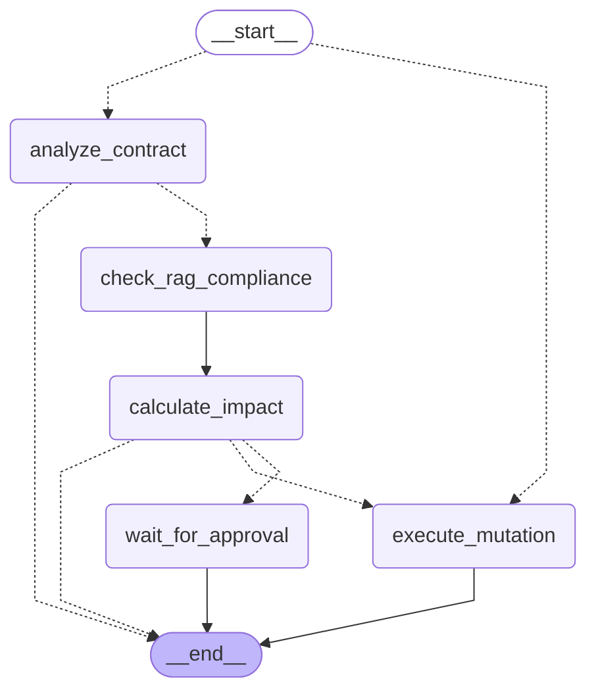

# Governance agent: LangGraph StateGraph

Generated from `backend/app/services/agents/langgraph_governance.py` (`mermaid()`). Dashed edges are conditional.

| Node | What it does | Persisted state after it |
|---|---|---|
| `analyze_contract` | Validates customer, contract and status; loads plan, price, term, seats | `ANALYZING_CONTRACT`, or `REJECTED` on a rule violation |
| `check_rag_compliance` | Finds customer-specific MSA/SOW chunks by entity ID (no LLM), then asks the copilot to review them *outside* any DB transaction | `CALCULATING_IMPACT` |
| `calculate_impact` | SOP-02 math in `Decimal`: 30-day aggregate, MRR/ARR delta, tier range, HITL reasons | `APPROVED`, `REJECTED`, or still `CALCULATING_IMPACT` with reasons |
| `wait_for_approval` | Opens the HITL item, issues the single-use token, queues the n8n card; the graph run ends here | `WAITING_FOR_APPROVAL` |
| `execute_mutation` | The only node that changes seats/ARR: one locked transaction, never twice per request | `EXECUTED` (or `FAILED`, nothing applied) |

The checkpoint is `governance_runs`. There's no LangGraph checkpointer, because a second copy of run state could disagree with the database the money moves in. An approval re-enters the same compiled graph: the entry router sends a persisted `APPROVED` run straight to `execute_mutation`. Routing reads only the persisted state and the deterministic HITL reasons. The copilot's review can add a reason, never remove one.
